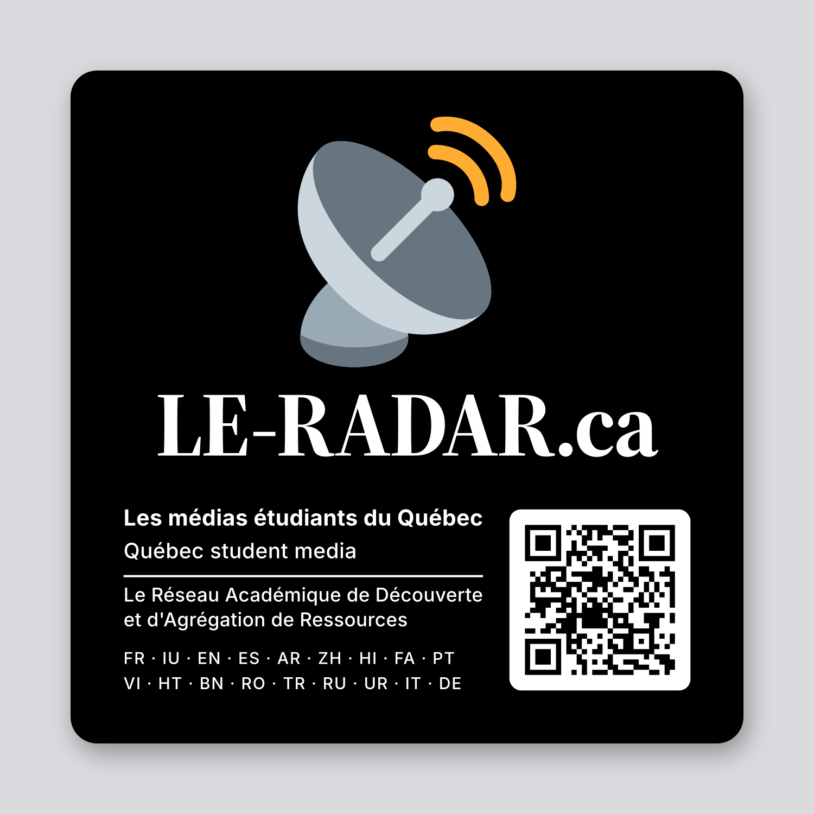

# Autocollant LE-RADAR.ca (3 × 3 po)

Autocollant carré officiel de **LE-RADAR.ca** : fond noir, logo satellite, mot-symbole,
slogan, nom complet, langues du site et code QR vers le site. Prêt à envoyer à un
imprimeur d'autocollants.

## Contenu

| Fichier | Rôle |
|---|---|
| `autocollant-le-radar-3x3in-bleed.pdf` | Production : vectoriel, noir riche C60 M40 Y40 K100, fond perdu 3 mm, TrimBox, tracé **CutContour** (couleur d'accompagnement) |
| `autocollant-le-radar-3x3in-bleed_K100.pdf` | Même fichier avec noir pur K100 |
| `autocollant-le-radar-3x3in-bleed.svg` | Version vectorielle (groupes `Artwork` et `CutContour`), texte en contours |
| `autocollant-le-radar-2400.png` | PNG 2400 × 2400 px (fond perdu inclus, sans tracé de coupe) |
| `autocollant-le-radar-preview.png` | Aperçu 1500 × 1500 sur fond gris (pas pour l'impression) |
| `specs-fournisseur.md` | Dimensions, finitions (vinyle, laminage, découpe), couleurs, quantités |
| `LICENCES-et-credits.md` | Licences des polices et du logo |

## Spécifications en bref

- **Format** : 76,2 × 76,2 mm (3 × 3 po), coins arrondis de 3 mm, fond perdu de 3 mm (fichier de 82,2 × 82,2 mm).
- **Typographie** : « LE-RADAR.ca » en Source Serif 4 Display Bold (police du mot-symbole officiel, `wordmark-on-dark.svg`), le reste en Inter ; tout est converti en contours.
- **Langues affichées** : celles du menu de traduction du site (`translate-menu.js`), du français à l'allemand, y compris l'inuktitut (IU), seule langue autochtone actuellement offerte (`indigenous-mt.json`).
- **Code QR** : encode `https://le-radar.ca`, correction d'erreur niveau H, tuile blanche de 20,5 mm avec zone de silence ; lecture vérifiée par décodage logiciel. À valider au téléphone sur l'épreuve de l'imprimeur.
- **Finition recommandée** (usage extérieur, lieux publics) : vinyle blanc durable, laminé transparent, découpe à la forme (die-cut) avec le tracé `CutContour`.

## Crédits

Le logo (satellite) est le pictogramme Twemoji, © Twitter, Inc. et autres contributeurs, licence
**CC-BY 4.0** : « Graphique : Twemoji, CC-BY 4.0 ». Les polices Source Serif 4 et Inter sont
sous licence SIL OFL 1.1. Détails dans `LICENCES-et-credits.md`.
